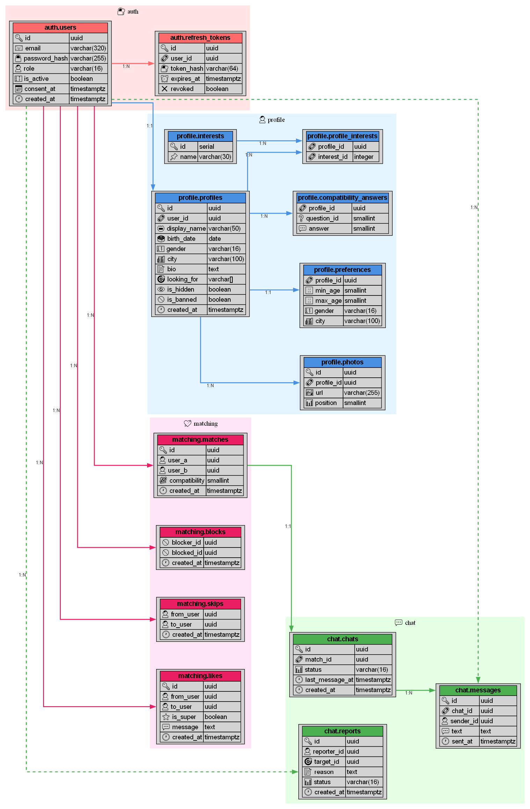

# Affinity

Учебное веб-приложение для знакомств на микросервисной архитектуре.

Пользователи заполняют анкету, проходят короткий тест на совместимость и ставят лайки.
При взаимной симпатии появляется мэтч и открывается чат. Сервис только для пользователей 18+.

## Стек

- **Backend:** Python, FastAPI, 4 микросервиса
- **База данных:** PostgreSQL (своя схема на каждый сервис), миграции Alembic
- **Кэш:** Redis
- **Шлюз:** nginx
- **Фронтенд:** HTML / CSS / JavaScript
- **Запуск:** Docker, docker-compose

## Сервисы

| Сервис             | За что отвечает                               |
|--------------------|-----------------------------------------------|
| `auth-service`     | Регистрация, вход, JWT-токены, роли           |
| `profile-service`  | Анкеты, фото, тест на совместимость           |
| `matching-service` | Лента анкет, лайки, мэтчи, дневные лимиты     |
| `chat-service`     | Чат, WebSocket, жалобы                        |

## База данных

### Хранилище и принцип разделения

В системе используется один сервер **PostgreSQL**. База разделена по принципу
*«схема на сервис»* (database-per-service): каждый микросервис владеет собственной
схемой и работает только с ней (НФТ-9) — чужие таблицы сервис не читает,
данные других сервисов получаются только через их API.

| Схема | Сервис | Что хранит |
| --- | --- | --- |
| `auth` | auth-service | Пользователи, refresh-токены |
| `profile` | profile-service | Анкеты, фото, интересы, предпочтения поиска, ответы теста |
| `matching` | matching-service | Лайки, пропуски, блокировки, мэтчи |
| `chat` | chat-service | Чаты, сообщения, жалобы |

Структура БД создаётся и изменяется только через **миграции Alembic** (НФТ-8).
Данные и загруженные фото переживают перезапуск контейнеров благодаря Docker-томам (НФТ-7).

### Таблицы и их назначение

#### `auth` — пользователи и доступ

| Таблица | Зачем нужна |
| --- | --- |
| `users` | Все пользователи системы: email (уникальный), хеш пароля (bcrypt, сам пароль не хранится), роль (`user` / `admin`), флаг активности аккаунта и время согласия на обработку персональных данных (`consent_at` — требование закона, регистрация только 18+ и только с согласия) |
| `refresh_tokens` | Refresh-токены: хранится только **хеш** токена, срок жизни и флаг отзыва (`revoked`) — обеспечивает выход из системы и принудительный отзыв токена |

Учётная запись администратора создаётся автоматически при старте auth-service
из переменных окружения (ФТ-5.1), вручную в БД её добавлять не нужно.

#### `profile` — анкета и совместимость

| Таблица | Зачем нужна |
| --- | --- |
| `profiles` | Анкета пользователя (строго одна на пользователя): имя, дата рождения, пол, город, «о себе», цель знакомства (`looking_for`), флаги «скрыта из ленты» и «заблокирован» |
| `interests` | Справочник тегов интересов: «спорт», «путешествия» и т.п. |
| `profile_interests` | Связка «анкета ↔ интерес» (многие-ко-многим) |
| `photos` | Фотографии анкеты (от 1 до 3); `position` задаёт порядок в карточке |
| `preferences` | Настройки поиска (одни на анкету): возрастной диапазон, пол, город |
| `compatibility_answers` | Ответы теста на совместимость: 10 вопросов, ответ — число 0–4 («нет» … «да») |

#### `matching` — симпатии и мэтчи

| Таблица | Зачем нужна |
| --- | --- |
| `likes` | Лайки; супер-лайк отмечается флагом `is_super` и может содержать сообщение. Пара уникальна — повторный лайк невозможен |
| `skips` | Пропуски: анкета не показывается в ленте повторно последние 7 дней |
| `blocks` | Блокировки: заблокированные пользователи не видят друг друга в ленте и не могут писать друг другу |
| `matches` | Мэтч — взаимный лайк. Процент совместимости фиксируется в момент мэтча (`compatibility`) и больше не пересчитывается |

#### `chat` — общение и жалобы

| Таблица | Зачем нужна |
| --- | --- |
| `chats` | Чат: создаётся один на мэтч (`match_id`), статус `active` / `archived` (автоархивация после 7 дней без сообщений) |
| `messages` | Сообщения чатов |
| `reports` | Жалобы на пользователей: причина и статус (`open` / рассмотрена) |

### Связи между таблицами

Связи бывают **двух видов**.

**1. Внутри схемы — внешние ключи (FOREIGN KEY).**
Их немного, и все они внутри одной схемы:

- `auth.refresh_tokens.user_id → auth.users.id` (ON DELETE CASCADE);
- `profile.profile_interests`, `profile.photos`, `profile.preferences`,
  `profile.compatibility_answers → profile.profiles.id` (а `profile_interests` ещё и → `profile.interests.id`), все с ON DELETE CASCADE;
- `chat.messages.chat_id → chat.chats.id` (ON DELETE CASCADE).

Благодаря каскаду удаление анкеты автоматически чистит её фото, интересы,
предпочтения и ответы теста.

**2. Между схемами — связи по значению (UUID без внешнего ключа).**
Следующие поля указывают на сущности других сервисов, но внешними ключами **не** являются:

| Поле | На что указывает по смыслу |
| --- | --- |
| `profile.profiles.user_id` | Владелец анкеты (`auth.users.id`) |
| `matching.likes.from_user`, `to_user` | Автор и адресат лайка |
| `matching.skips.from_user`, `to_user` | Участники пропуска |
| `matching.blocks.blocker_id`, `blocked_id` | Кто кого заблокировал |
| `matching.matches.user_a`, `user_b` | Участники мэтча |
| `chat.chats.match_id` | Мэтч, для которого создан чат (`matching.matches.id`) |
| `chat.messages.sender_id` | Отправитель сообщения |
| `chat.reports.reporter_id`, `target_id` | Заявитель и тот, на кого жалоба |

**Почему без внешних ключей.** Внешний ключ между схемами связал бы сервисы
на уровне базы и нарушил границы владения (НФТ-9): схемы «узнали» бы друг о друге,
а сервисы перестали бы быть независимыми — их нельзя было бы разрабатывать,
мигрировать и масштабировать по отдельности (вплоть до разнесения по разным серверам БД).
Каждая схема полностью принадлежит своему сервису.

**Как поддерживается целостность без FK.**

- UUID сущностей генерирует и владеет ими сервис-владелец;
- перед созданием объекта с «чужим» id (лайк, мэтч, чат) сервис проверяет
  существование пользователя или мэтча через внутренние API — они недоступны извне (НФТ-4);
- удаление аккаунта (ФТ-1.7) выполняется каскадно через API: auth-service сообщает
  остальным сервисам, и каждый удаляет свои данные (анкеты, лайки, мэтчи, чаты);
- внутри сервиса целостность дополнительно гарантируют ограничения уникальности
  (одна анкета на пользователя, один лайк на пару, один чат на мэтч).

### Диаграмма схемы

Сплошные линии — внешние ключи внутри схемы; пунктирные — связи между схемами
по значению (UUID без FK).


### Redis: что хранится вне PostgreSQL

Redis дополняет PostgreSQL и держит то, что не требует долговременного хранения:

- **битовые маски ответов теста** (10 вопросов × 4 бита, кодирование «термометром») —
  по ним расстояние Хэмминга и процент совместимости считаются за O(1);
- кэш ленты и карточек анкет (сбрасывается при изменении анкеты, НФТ-11);
- счётчики дневных лимитов лайков и супер-лайков (сброс в полночь по Europe/Moscow);
- счётчики rate-limit (вход: 5 попыток за 5 минут; сообщения: 30 за 60 секунд);
- флаг «печатает…» с временем жизни 5 секунд.

## Запуск

Нужен установленный и запущенный [Docker Desktop](https://www.docker.com/products/docker-desktop/).

```bash
git clone https://github.com/a-slelin/affinity.git
cd affinity
cp .env.example .env     # на Windows: copy .env.example .env
docker compose up --build
```

После запуска откройте:

- приложение — http://localhost:8080
- документация API (Swagger) — `http://localhost:8080/api/<сервис>/docs`,
  где `<сервис>` — `auth`, `profiles`, `matching` или `chat`

Остановить: `Ctrl+C`, затем `docker compose down`.

## Документация

Техническое задание — в папке [`TechSpec`](TechSpec/).

## Команда

| Участник          | Роль |
|-------------------|------|
| a-slelin          |      |
| Konsulot          |      |
| Dominus-Exitio    |      |
| AdskiySotona666   |      |
